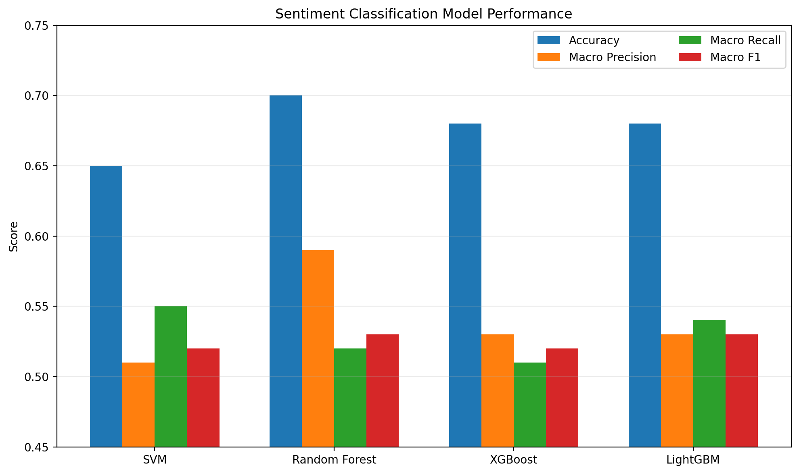
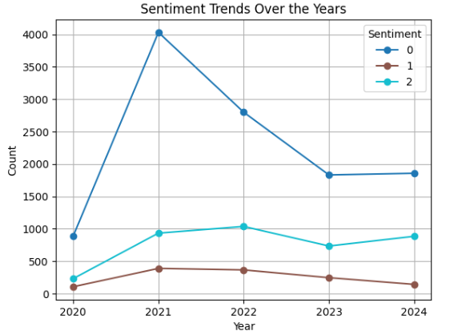
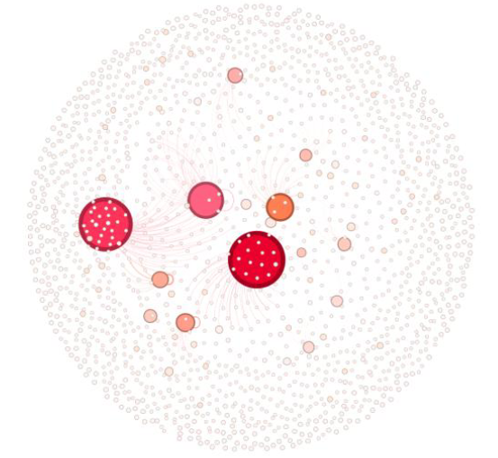

# Sentiment & Social Network Analysis of Merdeka Curriculum Discourse on X

Portfolio repository for the published study **“Sentiment and Social Network Analysis of X Social Media on the Implementation of the Merdeka Belajar Curriculum in Indonesia”**, published in the **Journal of Advanced Technology and Multidiscipline (JATM), Vol. 4 No. 2, 2025**.

The project analyzes public discourse on X using two complementary analytical pipelines:

- **Sentiment Analysis** to classify public opinion into neutral, positive, and negative sentiment.
- **Social Network Analysis (SNA)** to identify influential accounts and communication structures within the discussion network.

The two pipelines were implemented separately and interpreted side by side to provide a broader view of both public sentiment and information flow.

## Publication

**Title:** Sentiment and Social Network Analysis of X Social Media on the Implementation of the Merdeka Belajar Curriculum in Indonesia  
**Journal:** Journal of Advanced Technology and Multidiscipline  
**Volume:** 4  
**Issue:** 2  
**Year:** 2025  
**DOI:** 10.20473/jatm.v4i2.71938

## Dataset

The study analyzed **16,455 tweets** collected from X between **January 2020 and November 2024** using the keywords:

- Kurikulum Merdeka
- Merdeka Belajar
- Kurikulum Nadiem

The data were used for both sentiment classification and social network analysis.

## Sentiment Analysis

The sentiment-analysis workflow included:

**Text Preprocessing → Sentiment Labeling → Train/Test Split → TF-IDF Vectorization → SMOTE → Model Training → Evaluation**

Four machine-learning models were compared:

- Support Vector Machine
- Random Forest
- XGBoost
- LightGBM

TF-IDF was configured with a maximum of **5,000 features**, while SMOTE was applied only to the training data after splitting to reduce data leakage risk.

### Model Performance

| Model | Accuracy | Macro Precision | Macro Recall | Macro F1-Score |
|---|---:|---:|---:|---:|
| SVM | 0.65 | 0.51 | 0.55 | 0.52 |
| **Random Forest** | **0.70** | **0.59** | 0.52 | **0.53** |
| XGBoost | 0.68 | 0.53 | 0.51 | 0.52 |
| LightGBM | 0.68 | 0.53 | **0.54** | **0.53** |

**Random Forest achieved the highest accuracy at 70%.**

## Social Network Analysis

The SNA pipeline was used to analyze interaction patterns and identify strategically positioned accounts using:

- Degree Centrality
- Betweenness Centrality
- Closeness Centrality

Network visualization and community analysis were conducted using **Gephi**.

### Key Actors

Accounts with high degree and closeness centrality included:

- `@nadiemmakarim`
- `@Kemdikbud_RI`
- `@collegemenfess`

Meanwhile, accounts such as:

- `@adekumala`
- `@MasMenteri`
- `@PBPGRI_OFFICIAL`

showed notable betweenness centrality and acted as bridges between parts of the network.

## Key Findings

Public discussion was dominated by **neutral and negative sentiment**, while positive sentiment represented a smaller share of the discourse.

The network analysis also showed that highly mentioned accounts were not always the same actors functioning as bridges between communities, highlighting different forms of influence within the discussion network.

## Results Visualization

### Sentiment Classification Performance


### Sentiment Trend Over Time


### Social Network Visualization


## Tools & Technologies

- Python
- Pandas
- Scikit-learn
- Imbalanced-learn
- TF-IDF
- SMOTE
- Random Forest
- XGBoost
- LightGBM
- NetworkX
- Gephi
- Matplotlib
- Seaborn

## Repository Contents

```text
merdeka-curriculum-sentiment-network-analysis/
├── README.md
├── sentiment_analysis_public.ipynb
├── social_network_analysis_public.ipynb
└── requirements.txt
```

## Notes

This repository is a portfolio version of the published research project.

Raw social-media data, usernames, tweet URLs, and other source-level data are intentionally excluded from this public repository.
